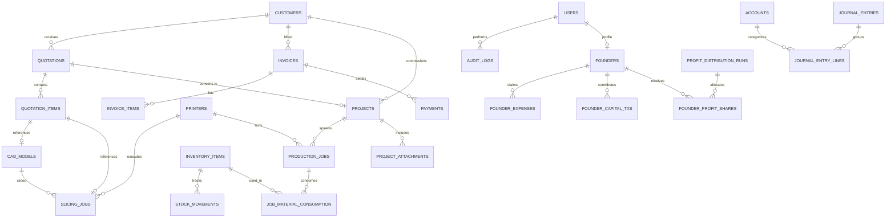

# Workshop OS – Database Entity Relationship & Schema Design

This document details the PostgreSQL relational schema for Workshop OS. All financial calculations use `NUMERIC(15, 2)` (or `NUMERIC(18, 4)` for high-precision rates), and primary keys use UUID v4 or sequential alphanumeric identifiers where user-facing (`QT-2026-0001`, `INV-2026-0001`, etc.).

---

## 1. Entity Relationship Overview



---

## 2. Table Specifications by Domain

### 2.1 Identity, Users & RBAC
```sql
CREATE TYPE user_role AS ENUM (
    'SUPER_ADMIN', 
    'FOUNDER', 
    'ACCOUNTANT', 
    'TECHNICIAN', 
    'EMPLOYEE'
);

CREATE TABLE users (
    id UUID PRIMARY KEY DEFAULT gen_random_uuid(),
    email VARCHAR(255) UNIQUE NOT NULL,
    password_hash VARCHAR(255) NOT NULL,
    full_name VARCHAR(150) NOT NULL,
    phone VARCHAR(50),
    role user_role NOT NULL DEFAULT 'EMPLOYEE',
    is_active BOOLEAN NOT NULL DEFAULT TRUE,
    created_at TIMESTAMPTZ NOT NULL DEFAULT CURRENT_TIMESTAMP,
    updated_at TIMESTAMPTZ NOT NULL DEFAULT CURRENT_TIMESTAMP
);

CREATE TABLE audit_logs (
    id UUID PRIMARY KEY DEFAULT gen_random_uuid(),
    user_id UUID REFERENCES users(id) ON DELETE SET NULL,
    action VARCHAR(100) NOT NULL, -- e.g. "POST_JOURNAL_ENTRY", "CREATE_REVERSAL"
    entity_name VARCHAR(100) NOT NULL,
    entity_id VARCHAR(100) NOT NULL,
    ip_address VARCHAR(45),
    user_agent TEXT,
    changes JSONB, -- { old_values: {...}, new_values: {...} }
    created_at TIMESTAMPTZ NOT NULL DEFAULT CURRENT_TIMESTAMP
);
CREATE INDEX idx_audit_entity ON audit_logs(entity_name, entity_id);
```

---

### 2.2 Customers & CRM
```sql
CREATE TYPE customer_type AS ENUM ('INDIVIDUAL', 'BUSINESS');

CREATE TABLE customers (
    id UUID PRIMARY KEY DEFAULT gen_random_uuid(),
    customer_code VARCHAR(50) UNIQUE NOT NULL, -- CUST-0001
    customer_type customer_type NOT NULL DEFAULT 'INDIVIDUAL',
    company_name VARCHAR(200),
    contact_person VARCHAR(150) NOT NULL,
    email VARCHAR(255) NOT NULL,
    phone VARCHAR(50) NOT NULL,
    billing_address TEXT,
    shipping_address TEXT,
    tax_id_number VARCHAR(100),
    credit_limit NUMERIC(15, 2) NOT NULL DEFAULT 0.00,
    notes TEXT,
    created_at TIMESTAMPTZ NOT NULL DEFAULT CURRENT_TIMESTAMP,
    updated_at TIMESTAMPTZ NOT NULL DEFAULT CURRENT_TIMESTAMP
);
CREATE INDEX idx_customer_code ON customers(customer_code);
```

---

### 2.3 3D Printing & Manufacturing Fleet
```sql
CREATE TYPE printer_technology AS ENUM ('FDM', 'SLA', 'SLS');
CREATE TYPE printer_status AS ENUM ('IDLE', 'PRINTING', 'MAINTENANCE', 'OFFLINE');

CREATE TABLE printers (
    id UUID PRIMARY KEY DEFAULT gen_random_uuid(),
    name VARCHAR(100) NOT NULL, -- "Prusa MK4 #1"
    model VARCHAR(100) NOT NULL,
    serial_number VARCHAR(100),
    technology printer_technology NOT NULL DEFAULT 'FDM',
    build_volume_x_mm NUMERIC(8, 2) NOT NULL,
    build_volume_y_mm NUMERIC(8, 2) NOT NULL,
    build_volume_z_mm NUMERIC(8, 2) NOT NULL,
    nozzle_diameter_mm NUMERIC(4, 2) NOT NULL DEFAULT 0.40,
    status printer_status NOT NULL DEFAULT 'IDLE',
    hourly_depreciation_rate_lkr NUMERIC(15, 2) NOT NULL DEFAULT 150.00,
    power_rating_watts NUMERIC(8, 2) NOT NULL DEFAULT 250.00,
    maintenance_interval_hours INT NOT NULL DEFAULT 300,
    total_operating_hours NUMERIC(10, 2) NOT NULL DEFAULT 0.00,
    created_at TIMESTAMPTZ NOT NULL DEFAULT CURRENT_TIMESTAMP
);

CREATE TABLE pricing_profiles (
    id UUID PRIMARY KEY DEFAULT gen_random_uuid(),
    profile_name VARCHAR(100) NOT NULL,
    is_active BOOLEAN NOT NULL DEFAULT TRUE,
    electricity_cost_per_kwh_lkr NUMERIC(10, 2) NOT NULL DEFAULT 65.00,
    technician_labor_rate_hourly_lkr NUMERIC(10, 2) NOT NULL DEFAULT 1200.00,
    post_processing_rate_hourly_lkr NUMERIC(10, 2) NOT NULL DEFAULT 800.00,
    default_failure_risk_pct NUMERIC(5, 2) NOT NULL DEFAULT 10.00, -- 10% contingency
    default_wastage_allowance_pct NUMERIC(5, 2) NOT NULL DEFAULT 8.00, -- 8% purge/support wastage
    default_profit_margin_pct NUMERIC(5, 2) NOT NULL DEFAULT 40.00, -- 40% target margin
    min_order_charge_lkr NUMERIC(15, 2) NOT NULL DEFAULT 1500.00,
    created_at TIMESTAMPTZ NOT NULL DEFAULT CURRENT_TIMESTAMP
);

CREATE TABLE cad_models (
    id UUID PRIMARY KEY DEFAULT gen_random_uuid(),
    original_filename VARCHAR(255) NOT NULL,
    stored_file_path VARCHAR(500) NOT NULL,
    file_format VARCHAR(20) NOT NULL, -- "STL", "3MF", "OBJ", "STEP"
    file_size_bytes BIGINT NOT NULL,
    sha256_hash VARCHAR(64) NOT NULL,
    bounding_box_x_mm NUMERIC(8, 2),
    bounding_box_y_mm NUMERIC(8, 2),
    bounding_box_z_mm NUMERIC(8, 2),
    mesh_volume_cm3 NUMERIC(10, 3),
    uploaded_by_id UUID REFERENCES users(id),
    created_at TIMESTAMPTZ NOT NULL DEFAULT CURRENT_TIMESTAMP
);

CREATE TYPE slicer_engine AS ENUM ('PRUSA_SLICER', 'ORCA_SLICER');
CREATE TYPE slicer_job_status AS ENUM ('PENDING', 'PROCESSING', 'COMPLETED', 'FAILED');

CREATE TABLE slicing_jobs (
    id UUID PRIMARY KEY DEFAULT gen_random_uuid(),
    cad_model_id UUID NOT NULL REFERENCES cad_models(id) ON DELETE CASCADE,
    printer_id UUID NOT NULL REFERENCES printers(id),
    pricing_profile_id UUID REFERENCES pricing_profiles(id),
    slicer_engine slicer_engine NOT NULL DEFAULT 'PRUSA_SLICER',
    layer_height_mm NUMERIC(4, 2) NOT NULL DEFAULT 0.20,
    infill_percentage INT NOT NULL DEFAULT 20,
    infill_pattern VARCHAR(50) NOT NULL DEFAULT 'grid',
    support_enabled BOOLEAN NOT NULL DEFAULT FALSE,
    status slicer_job_status NOT NULL DEFAULT 'PENDING',
    
    -- Extracted Telemetry
    filament_used_grams NUMERIC(10, 2),
    filament_used_length_mm NUMERIC(12, 2),
    estimated_duration_seconds INT,
    layer_count INT,
    gcode_file_path VARCHAR(500),
    slicer_log TEXT,
    config_snapshot JSONB, -- exact slicer CLI args and profile INI snapshot
    
    -- Cost breakdown calculated by engine
    calculated_filament_cost_lkr NUMERIC(15, 2),
    calculated_machine_cost_lkr NUMERIC(15, 2),
    calculated_electricity_cost_lkr NUMERIC(15, 2),
    calculated_labor_cost_lkr NUMERIC(15, 2),
    suggested_price_lkr NUMERIC(15, 2),
    
    created_at TIMESTAMPTZ NOT NULL DEFAULT CURRENT_TIMESTAMP,
    completed_at TIMESTAMPTZ
);
```

---

### 2.4 PCB & Engineering Services
```sql
CREATE TYPE engineering_category AS ENUM (
    'PCB_DESIGN', 
    'PCB_FABRICATION', 
    'PCB_ASSEMBLY', 
    'COMPONENT_SOURCING', 
    'ELECTRONICS_PROTOTYPING', 
    'CAD_3D_MODELING', 
    'ENGINEERING_CONSULTATION', 
    'CUSTOM_DEVELOPMENT'
);

CREATE TYPE billing_unit AS ENUM (
    'PER_HOUR', 
    'FIXED_PRICE', 
    'PER_SQ_CM', 
    'PER_SMT_PIN', 
    'PER_THT_PIN'
);

CREATE TABLE engineering_service_catalog (
    id UUID PRIMARY KEY DEFAULT gen_random_uuid(),
    service_code VARCHAR(50) UNIQUE NOT NULL, -- ENG-PCB-01
    name VARCHAR(150) NOT NULL,
    category engineering_category NOT NULL,
    billing_unit billing_unit NOT NULL,
    default_rate_lkr NUMERIC(15, 2) NOT NULL,
    description TEXT,
    is_active BOOLEAN NOT NULL DEFAULT TRUE
);
```

---

### 2.5 Quotations & Revisions
```sql
CREATE TYPE quotation_status AS ENUM (
    'DRAFT', 
    'SENT', 
    'ACCEPTED', 
    'REJECTED', 
    'EXPIRED', 
    'SUPERSEDED'
);

CREATE TABLE quotations (
    id UUID PRIMARY KEY DEFAULT gen_random_uuid(),
    quote_number VARCHAR(50) NOT NULL, -- e.g. QT-2026-0001
    revision_number INT NOT NULL DEFAULT 1,
    customer_id UUID NOT NULL REFERENCES customers(id),
    title VARCHAR(200) NOT NULL,
    status quotation_status NOT NULL DEFAULT 'DRAFT',
    currency VARCHAR(3) NOT NULL DEFAULT 'LKR',
    subtotal_lkr NUMERIC(15, 2) NOT NULL DEFAULT 0.00,
    discount_amount_lkr NUMERIC(15, 2) NOT NULL DEFAULT 0.00,
    tax_rate_pct NUMERIC(5, 2) NOT NULL DEFAULT 0.00,
    tax_amount_lkr NUMERIC(15, 2) NOT NULL DEFAULT 0.00,
    grand_total_lkr NUMERIC(15, 2) NOT NULL DEFAULT 0.00,
    valid_until DATE NOT NULL,
    terms_and_conditions TEXT,
    notes TEXT,
    created_by_id UUID REFERENCES users(id),
    created_at TIMESTAMPTZ NOT NULL DEFAULT CURRENT_TIMESTAMP,
    updated_at TIMESTAMPTZ NOT NULL DEFAULT CURRENT_TIMESTAMP,
    CONSTRAINT uq_quote_revision UNIQUE (quote_number, revision_number)
);

CREATE TYPE quotation_item_type AS ENUM (
    '3D_PRINTING', 
    'PCB_SERVICE', 
    'ENGINEERING_HOURLY', 
    'INVENTORY_PART', 
    'CUSTOM'
);

CREATE TABLE quotation_items (
    id UUID PRIMARY KEY DEFAULT gen_random_uuid(),
    quotation_id UUID NOT NULL REFERENCES quotations(id) ON DELETE CASCADE,
    item_type quotation_item_type NOT NULL,
    cad_model_id UUID REFERENCES cad_models(id),
    slicing_job_id UUID REFERENCES slicing_jobs(id),
    service_id UUID REFERENCES engineering_service_catalog(id),
    description TEXT NOT NULL,
    quantity NUMERIC(10, 2) NOT NULL DEFAULT 1.00,
    unit_cost_lkr NUMERIC(15, 2) NOT NULL DEFAULT 0.00,
    unit_price_lkr NUMERIC(15, 2) NOT NULL DEFAULT 0.00,
    total_price_lkr NUMERIC(15, 2) NOT NULL DEFAULT 0.00,
    pricing_breakdown JSONB, -- stores cost engine inputs & margin breakdown
    sort_order INT NOT NULL DEFAULT 0
);
```

---

### 2.6 Projects & Production Jobs
```sql
CREATE TYPE project_status AS ENUM (
    'PLANNING', 
    'IN_PROGRESS', 
    'ON_HOLD', 
    'QA_REVIEW', 
    'COMPLETED', 
    'CANCELLED'
);

CREATE TABLE projects (
    id UUID PRIMARY KEY DEFAULT gen_random_uuid(),
    project_code VARCHAR(50) UNIQUE NOT NULL, -- PRJ-2026-0001
    quotation_id UUID REFERENCES quotations(id),
    customer_id UUID NOT NULL REFERENCES customers(id),
    name VARCHAR(200) NOT NULL,
    description TEXT,
    status project_status NOT NULL DEFAULT 'PLANNING',
    lead_founder_id UUID REFERENCES users(id),
    start_date DATE,
    target_delivery_date DATE,
    actual_completion_date DATE,
    total_budget_lkr NUMERIC(15, 2) NOT NULL DEFAULT 0.00,
    created_at TIMESTAMPTZ NOT NULL DEFAULT CURRENT_TIMESTAMP,
    updated_at TIMESTAMPTZ NOT NULL DEFAULT CURRENT_TIMESTAMP
);

CREATE TYPE production_job_status AS ENUM (
    'QUEUED', 
    'SETUP', 
    'IN_PRODUCTION', 
    'POST_PROCESSING', 
    'QA_PENDING', 
    'QA_PASSED', 
    'FAILED', 
    'COMPLETED'
);

CREATE TABLE production_jobs (
    id UUID PRIMARY KEY DEFAULT gen_random_uuid(),
    job_number VARCHAR(50) UNIQUE NOT NULL, -- JOB-2026-0001
    project_id UUID NOT NULL REFERENCES projects(id) ON DELETE CASCADE,
    quotation_item_id UUID REFERENCES quotation_items(id),
    printer_id UUID REFERENCES printers(id),
    assigned_to_id UUID REFERENCES users(id),
    status production_job_status NOT NULL DEFAULT 'QUEUED',
    scheduled_start TIMESTAMPTZ,
    actual_start TIMESTAMPTZ,
    actual_end TIMESTAMPTZ,
    actual_print_time_seconds INT,
    material_consumed_grams NUMERIC(10, 2) NOT NULL DEFAULT 0.00,
    gcode_file_path VARCHAR(500),
    failure_notes TEXT,
    qa_notes TEXT,
    qa_approved_by UUID REFERENCES users(id),
    created_at TIMESTAMPTZ NOT NULL DEFAULT CURRENT_TIMESTAMP
);

CREATE TABLE job_time_logs (
    id UUID PRIMARY KEY DEFAULT gen_random_uuid(),
    production_job_id UUID NOT NULL REFERENCES production_jobs(id) ON DELETE CASCADE,
    user_id UUID NOT NULL REFERENCES users(id),
    work_stage VARCHAR(50) NOT NULL, -- "SETUP", "MACHINE_SUPERVISION", "SOLDERING", "QA"
    start_time TIMESTAMPTZ NOT NULL,
    end_time TIMESTAMPTZ NOT NULL,
    duration_minutes INT NOT NULL,
    notes TEXT
);
```

---

### 2.7 Inventory & Material Consumption
```sql
CREATE TABLE inventory_categories (
    id UUID PRIMARY KEY DEFAULT gen_random_uuid(),
    name VARCHAR(100) NOT NULL, -- "Filaments", "Resins", "Microcontrollers", "Passive Components"
    parent_id UUID REFERENCES inventory_categories(id)
);

CREATE TABLE suppliers (
    id UUID PRIMARY KEY DEFAULT gen_random_uuid(),
    supplier_code VARCHAR(50) UNIQUE NOT NULL,
    name VARCHAR(200) NOT NULL,
    contact_person VARCHAR(150),
    email VARCHAR(255),
    phone VARCHAR(50),
    address TEXT,
    created_at TIMESTAMPTZ NOT NULL DEFAULT CURRENT_TIMESTAMP
);

CREATE TABLE inventory_items (
    id UUID PRIMARY KEY DEFAULT gen_random_uuid(),
    sku VARCHAR(100) UNIQUE NOT NULL,
    name VARCHAR(200) NOT NULL,
    category_id UUID REFERENCES inventory_categories(id),
    unit_of_measure VARCHAR(20) NOT NULL, -- "GRAM", "PIECE", "METER", "ROLL"
    current_stock_quantity NUMERIC(12, 3) NOT NULL DEFAULT 0.000,
    minimum_reorder_level NUMERIC(12, 3) NOT NULL DEFAULT 0.000,
    weighted_avg_unit_cost_lkr NUMERIC(15, 2) NOT NULL DEFAULT 0.00,
    location_bin VARCHAR(50), -- "Shelf B, Rack 2"
    supplier_id UUID REFERENCES suppliers(id),
    created_at TIMESTAMPTZ NOT NULL DEFAULT CURRENT_TIMESTAMP,
    updated_at TIMESTAMPTZ NOT NULL DEFAULT CURRENT_TIMESTAMP
);

CREATE TYPE stock_movement_type AS ENUM (
    'PURCHASE_RECEIPT', 
    'PRODUCTION_CONSUMPTION', 
    'SCRAP_WASTAGE', 
    'ADJUSTMENT_IN', 
    'ADJUSTMENT_OUT'
);

CREATE TABLE stock_movements (
    id UUID PRIMARY KEY DEFAULT gen_random_uuid(),
    item_id UUID NOT NULL REFERENCES inventory_items(id),
    movement_type stock_movement_type NOT NULL,
    quantity NUMERIC(12, 3) NOT NULL,
    unit_cost_lkr NUMERIC(15, 2) NOT NULL,
    total_cost_lkr NUMERIC(15, 2) NOT NULL,
    stock_after NUMERIC(12, 3) NOT NULL,
    reference_id VARCHAR(100), -- Production Job ID or PO ID
    performed_by_id UUID REFERENCES users(id),
    journal_entry_id UUID, -- Double-entry journal link
    notes TEXT,
    created_at TIMESTAMPTZ NOT NULL DEFAULT CURRENT_TIMESTAMP
);
```

---

### 2.8 Invoicing & Payments
```sql
CREATE TYPE invoice_status AS ENUM (
    'DRAFT', 
    'ISSUED', 
    'PARTIALLY_PAID', 
    'PAID', 
    'OVERDUE', 
    'VOID'
);

CREATE TABLE invoices (
    id UUID PRIMARY KEY DEFAULT gen_random_uuid(),
    invoice_number VARCHAR(50) UNIQUE NOT NULL, -- INV-2026-0001
    customer_id UUID NOT NULL REFERENCES customers(id),
    project_id UUID REFERENCES projects(id),
    quotation_id UUID REFERENCES quotations(id),
    issue_date DATE NOT NULL,
    due_date DATE NOT NULL,
    status invoice_status NOT NULL DEFAULT 'DRAFT',
    subtotal_lkr NUMERIC(15, 2) NOT NULL DEFAULT 0.00,
    discount_lkr NUMERIC(15, 2) NOT NULL DEFAULT 0.00,
    tax_lkr NUMERIC(15, 2) NOT NULL DEFAULT 0.00,
    grand_total_lkr NUMERIC(15, 2) NOT NULL DEFAULT 0.00,
    paid_amount_lkr NUMERIC(15, 2) NOT NULL DEFAULT 0.00,
    balance_due_lkr NUMERIC(15, 2) NOT NULL DEFAULT 0.00,
    pdf_file_path VARCHAR(500),
    created_at TIMESTAMPTZ NOT NULL DEFAULT CURRENT_TIMESTAMP,
    updated_at TIMESTAMPTZ NOT NULL DEFAULT CURRENT_TIMESTAMP
);

CREATE TYPE payment_method AS ENUM (
    'CASH', 
    'BANK_TRANSFER', 
    'CHEQUE', 
    'ONLINE_GATEWAY', 
    'FOUNDER_SETTLEMENT'
);

CREATE TABLE payments (
    id UUID PRIMARY KEY DEFAULT gen_random_uuid(),
    receipt_number VARCHAR(50) UNIQUE NOT NULL, -- REC-2026-0001
    invoice_id UUID NOT NULL REFERENCES invoices(id),
    customer_id UUID NOT NULL REFERENCES customers(id),
    payment_date DATE NOT NULL,
    amount_lkr NUMERIC(15, 2) NOT NULL,
    payment_method payment_method NOT NULL,
    reference_number VARCHAR(100), -- Cheque # or Bank Txn ID
    journal_entry_id UUID, -- Link to posted ledger transaction
    received_by_id UUID REFERENCES users(id),
    notes TEXT,
    created_at TIMESTAMPTZ NOT NULL DEFAULT CURRENT_TIMESTAMP
);
```

---

### 2.9 Double-Entry Accounting Engine
```sql
CREATE TYPE account_classification AS ENUM (
    'ASSET', 
    'LIABILITY', 
    'EQUITY', 
    'REVENUE', 
    'EXPENSE'
);

CREATE TABLE accounts (
    id UUID PRIMARY KEY DEFAULT gen_random_uuid(),
    code VARCHAR(20) UNIQUE NOT NULL, -- 1010, 1020, 2010, 3010, 4010, 5010
    name VARCHAR(150) NOT NULL,
    classification account_classification NOT NULL,
    is_active BOOLEAN NOT NULL DEFAULT TRUE,
    description TEXT
);

CREATE TYPE journal_entry_status AS ENUM ('DRAFT', 'POSTED', 'REVERSED');

CREATE TABLE journal_entries (
    id UUID PRIMARY KEY DEFAULT gen_random_uuid(),
    entry_number VARCHAR(50) UNIQUE NOT NULL, -- JE-2026-0001
    entry_date DATE NOT NULL,
    description TEXT NOT NULL,
    status journal_entry_status NOT NULL DEFAULT 'DRAFT',
    source_document VARCHAR(100), -- "INV-2026-0001", "REC-2026-0001", "FEXP-2026-0012"
    posted_by_id UUID REFERENCES users(id),
    reversal_of_id UUID REFERENCES journal_entries(id),
    created_at TIMESTAMPTZ NOT NULL DEFAULT CURRENT_TIMESTAMP
);

CREATE TABLE journal_entry_lines (
    id UUID PRIMARY KEY DEFAULT gen_random_uuid(),
    journal_entry_id UUID NOT NULL REFERENCES journal_entries(id) ON DELETE RESTRICT,
    account_id UUID NOT NULL REFERENCES accounts(id) ON DELETE RESTRICT,
    debit_lkr NUMERIC(15, 2) NOT NULL DEFAULT 0.00,
    credit_lkr NUMERIC(15, 2) NOT NULL DEFAULT 0.00,
    memo TEXT,
    CONSTRAINT chk_debit_credit_positive CHECK (debit_lkr >= 0 AND credit_lkr >= 0),
    CONSTRAINT chk_cannot_have_both CHECK (NOT (debit_lkr > 0 AND credit_lkr > 0))
);
```

---

### 2.10 Four-Founder Financial Management
```sql
CREATE TABLE founders (
    id UUID PRIMARY KEY DEFAULT gen_random_uuid(),
    user_id UUID UNIQUE NOT NULL REFERENCES users(id),
    display_name VARCHAR(100) NOT NULL,
    ownership_percentage NUMERIC(5, 2) NOT NULL, -- e.g. 25.00%
    profit_share_percentage NUMERIC(5, 2) NOT NULL, -- e.g. 25.00%
    capital_account_id UUID NOT NULL REFERENCES accounts(id), -- Equity: 3011-3014
    drawings_account_id UUID NOT NULL REFERENCES accounts(id), -- Equity Drawings: 3021-3024
    payable_account_id UUID NOT NULL REFERENCES accounts(id), -- Current Liability: 2051-2054
    is_active BOOLEAN NOT NULL DEFAULT TRUE,
    created_at TIMESTAMPTZ NOT NULL DEFAULT CURRENT_TIMESTAMP
);

CREATE TYPE founder_tx_type AS ENUM (
    'CAPITAL_INJECTION', 
    'DRAWING', 
    'REIMBURSEMENT_PAYOUT', 
    'EQUITY_CONVERSION'
);

CREATE TABLE founder_capital_transactions (
    id UUID PRIMARY KEY DEFAULT gen_random_uuid(),
    founder_id UUID NOT NULL REFERENCES founders(id),
    transaction_type founder_tx_type NOT NULL,
    amount_lkr NUMERIC(15, 2) NOT NULL,
    transaction_date DATE NOT NULL,
    journal_entry_id UUID REFERENCES journal_entries(id),
    approval_signatures JSONB NOT NULL DEFAULT '[]', -- Array of user_ids who approved
    notes TEXT,
    created_at TIMESTAMPTZ NOT NULL DEFAULT CURRENT_TIMESTAMP
);

CREATE TYPE expense_claim_status AS ENUM (
    'SUBMITTED', 
    'APPROVED', 
    'REIMBURSED', 
    'CONVERTED_TO_EQUITY', 
    'REJECTED'
);

CREATE TABLE founder_personal_expenses (
    id UUID PRIMARY KEY DEFAULT gen_random_uuid(),
    expense_number VARCHAR(50) UNIQUE NOT NULL, -- FEXP-2026-0001
    founder_id UUID NOT NULL REFERENCES founders(id),
    purchase_date DATE NOT NULL,
    vendor VARCHAR(200) NOT NULL,
    category_account_id UUID NOT NULL REFERENCES accounts(id), -- e.g. COGS or Operating Expense
    amount_lkr NUMERIC(15, 2) NOT NULL,
    description TEXT NOT NULL,
    receipt_file_path VARCHAR(500),
    status expense_claim_status NOT NULL DEFAULT 'SUBMITTED',
    approved_by_id UUID REFERENCES users(id),
    approved_at TIMESTAMPTZ,
    journal_entry_id UUID REFERENCES journal_entries(id),
    created_at TIMESTAMPTZ NOT NULL DEFAULT CURRENT_TIMESTAMP
);

CREATE TYPE distribution_status AS ENUM (
    'DRAFT', 
    'PENDING_SIGNATURES', 
    'APPROVED', 
    'EXECUTED', 
    'CANCELLED'
);

CREATE TABLE profit_distribution_runs (
    id UUID PRIMARY KEY DEFAULT gen_random_uuid(),
    run_number VARCHAR(50) UNIQUE NOT NULL, -- PDR-2026-01
    period_start DATE NOT NULL,
    period_end DATE NOT NULL,
    net_operating_profit_lkr NUMERIC(15, 2) NOT NULL,
    working_capital_reserve_pct NUMERIC(5, 2) NOT NULL DEFAULT 20.00,
    working_capital_reserve_lkr NUMERIC(15, 2) NOT NULL,
    tax_reserve_pct NUMERIC(5, 2) NOT NULL DEFAULT 15.00,
    tax_reserve_lkr NUMERIC(15, 2) NOT NULL,
    distributable_profit_pool_lkr NUMERIC(15, 2) NOT NULL,
    status distribution_status NOT NULL DEFAULT 'DRAFT',
    required_founder_signatures INT NOT NULL DEFAULT 4,
    signatures_collected JSONB NOT NULL DEFAULT '[]', -- [{founder_id, timestamp, ip}]
    journal_entry_id UUID REFERENCES journal_entries(id),
    created_at TIMESTAMPTZ NOT NULL DEFAULT CURRENT_TIMESTAMP
);

CREATE TABLE founder_profit_shares (
    id UUID PRIMARY KEY DEFAULT gen_random_uuid(),
    profit_distribution_run_id UUID NOT NULL REFERENCES profit_distribution_runs(id) ON DELETE CASCADE,
    founder_id UUID NOT NULL REFERENCES founders(id),
    profit_share_pct NUMERIC(5, 2) NOT NULL,
    share_amount_lkr NUMERIC(15, 2) NOT NULL,
    is_paid BOOLEAN NOT NULL DEFAULT FALSE,
    paid_date DATE,
    journal_entry_id UUID REFERENCES journal_entries(id)
);
```
