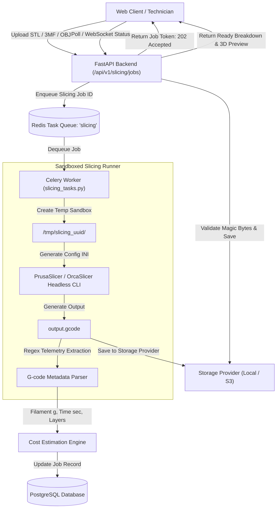

# Workshop OS – 3D Slicer Integration & Cost Estimation Engine

This document specifies the technical architecture for integrating command-line slicers (**PrusaSlicer** and **OrcaSlicer**) asynchronously into Workshop OS, parsing print telemetry from generated G-code, and executing multi-factor price estimation formulas in Sri Lankan Rupees (LKR).

---

## 1. Asynchronous Slicing Architecture

3D slicing can consume substantial CPU and RAM (e.g. slicing complex organic meshes with tree supports may take 20 to 90 seconds). Workshop OS offloads all slicing tasks from web worker threads to **Celery background workers** backed by Redis.



---

## 2. Security & Sandboxing Policies

Slicing untrusted user-submitted 3D meshes introduces serious risks:
1. **Command Injection Prevention:**
   - Under no circumstances is `shell=True` used.
   - Arguments are passed as sanitized string lists to `subprocess.run()`.
2. **Path Traversal Mitigation:**
   - Uploaded files are renamed using secure UUID v4 tokens (`cad_models/{uuid4}.stl`).
   - Original file names are preserved solely in database metadata fields.
3. **Execution Resource Quotas:**
   - Hard timeout: Tasks exceeding `120 seconds` are killed via `SIGKILL`.
   - Memory limits: Workers run with an OS-level virtual memory ceiling (`ulimit -v 2097152` = 2 GB).
4. **File Format & Magic Byte Verification:**
   - `.stl`: Checked for ASCII `solid` keyword or standard 80-byte binary header.
   - `.3mf`: Validated as a ZIP archive containing `3D/3dmodel.model`.
   - `.obj`: Verified for standard wavefront geometric vertex definitions (`v x y z`).

---

## 3. Slicer CLI Commands & Profile Configuration

### 3.1 PrusaSlicer Headless Invocation
PrusaSlicer supports full CLI execution without requiring a display:
```bash
prusa-slicer \
  --export-gcode \
  --load "/var/workshop/profiles/prusa_mk4_standard.ini" \
  --layer-height 0.20 \
  --fill-density 20% \
  --fill-pattern grid \
  --support-material \
  --output "/tmp/slice_job_123/output.gcode" \
  "/tmp/slice_job_123/input_model.stl"
```

### 3.2 OrcaSlicer Headless Invocation
OrcaSlicer builds on modern Prusa/Bambu codebases and may require a virtual framebuffer if compiled with GUI dependencies enabled:
```bash
xvfb-run -a orca-slicer \
  --slice 0 \
  --load-settings "/var/workshop/profiles/orca_bambu_p1s.json" \
  --output "/tmp/slice_job_123/output.gcode" \
  "/tmp/slice_job_123/input_model.3mf"
```

---

## 4. G-Code Telemetry Parser

Upon completion of the slicing subprocess, the worker streams the generated `.gcode` file to parse header and footer comments containing exact slicer metadata.

### Regex Extraction Rules:
- **Filament Mass (g):**
  - PrusaSlicer: `; filament used [g] = ([0-9.]+)`
  - OrcaSlicer: `; total filament used [g] = ([0-9.]+)`
- **Filament Length (mm):**
  - PrusaSlicer: `; filament used [mm] = ([0-9.]+)`
- **Estimated Print Time:**
  - PrusaSlicer: `; estimated printing time (normal mode) = (?:(\d+)d\s*)?(?:(\d+)h\s*)?(?:(\d+)m\s*)?(?:(\d+)s)?`
  - Converted automatically to total seconds:
    $$\text{Total Seconds} = (d \times 86400) + (h \times 3600) + (m \times 60) + s$$
- **Layer Count:**
  - `; total layers count = (\d+)`

---

## 5. Multi-Factor Price Estimation Engine

Slicer metadata only provides theoretical filament weight and printing duration. Workshop OS applies industrial costing rules to convert raw machine telemetry into an accurate, profitable selling price in **Sri Lankan Rupees (LKR)**.

### 5.1 Parameter Definitions
| Parameter | Symbol | Source | Example Value |
| :--- | :--- | :--- | :--- |
| Sliced Filament Weight | $W_{\text{slicer}}$ | G-code Parser | $145.0 \text{ g}$ |
| Spool Cost per Gram | $C_{\text{gram}}$ | Inventory Module | $\text{LKR } 8.50 \text{ / g}$ |
| Filament Wastage Allowance | $k_{\text{waste}}$ | Pricing Profile | $8\% \rightarrow 0.08$ |
| Sliced Print Duration | $T_{\text{sec}}$ | G-code Parser | $15,120 \text{ sec } (4.2 \text{ hrs})$ |
| Machine Depreciation Rate | $R_{\text{depr}}$ | Printer Profile | $\text{LKR } 180.00 \text{ / hr}$ |
| Printer Rated Power | $P_{\text{watts}}$ | Printer Profile | $250 \text{ W}$ |
| Electricity Tariff Rate | $R_{\text{elec}}$ | Pricing Profile | $\text{LKR } 65.00 \text{ / kWh}$ |
| Technician Setup Labor | $T_{\text{setup}}$ | Service Catalog | $0.25 \text{ hrs } (15 \text{ mins})$ |
| Technician Post-Processing | $T_{\text{post}}$ | Service Catalog | $0.50 \text{ hrs } (30 \text{ mins})$ |
| Labor Hourly Rate | $R_{\text{labor}}$ | Pricing Profile | $\text{LKR } 1,200.00 \text{ / hr}$ |
| Print Failure Contingency | $k_{\text{risk}}$ | Pricing Profile | $10\% \rightarrow 0.10$ |
| Desired Profit Margin | $M_{\text{profit}}$ | Pricing Profile | $40\% \rightarrow 0.40$ |
| Minimum Order Charge | $P_{\text{min}}$ | Pricing Profile | $\text{LKR } 1,500.00$ |

---

### 5.2 Step-by-Step Calculation Engine

#### 1. Material Cost ($C_{\text{mat}}$)
$$\text{Effective Weight} = W_{\text{slicer}} \times (1 + k_{\text{waste}}) = 145.0 \times 1.08 = 156.6 \text{ g}$$
$$C_{\text{mat}} = 156.6 \times 8.50 = \text{LKR } 1,331.10$$

#### 2. Machine Operating & Wear Cost ($C_{\text{mach}}$)
$$\text{Hours} = \frac{15120}{3600} = 4.20 \text{ hrs}$$
$$C_{\text{mach}} = 4.20 \times 180.00 = \text{LKR } 756.00$$

#### 3. Electricity Cost ($C_{\text{elec}}$)
$$\text{Energy (kWh)} = \frac{250 \text{ W}}{1000} \times 4.20 \text{ hrs} = 1.05 \text{ kWh}$$
$$C_{\text{elec}} = 1.05 \times 65.00 = \text{LKR } 68.25$$

#### 4. Direct Labor Cost ($C_{\text{labor}}$)
$$C_{\text{labor}} = (0.25 + 0.50) \times 1200.00 = 0.75 \times 1200.00 = \text{LKR } 900.00$$

#### 5. Total Direct Manufacturing Cost ($C_{\text{direct}}$)
$$C_{\text{direct}} = C_{\text{mat}} + C_{\text{mach}} + C_{\text{elec}} + C_{\text{labor}} = 1331.10 + 756.00 + 68.25 + 900.00 = \text{LKR } 3,055.35$$

#### 6. Risk-Adjusted Manufacturing Cost ($C_{\text{risk}}$)
Accounting for bed adhesion failure, nozzle clogs, or model distortion:
$$C_{\text{risk}} = C_{\text{direct}} \times (1 + k_{\text{risk}}) = 3055.35 \times 1.10 = \text{LKR } 3,360.89$$

#### 7. Suggested Selling Price ($P_{\text{quote}}$)
Applying target gross profit margin:
$$P_{\text{calculated}} = \frac{C_{\text{risk}}}{1 - M_{\text{profit}}} = \frac{3360.89}{1 - 0.40} = \text{LKR } 5,601.48$$
$$\text{Enforce Minimum Order Floor: } P_{\text{quote}} = \max(P_{\text{min}}, P_{\text{calculated}}) = \max(1500.00, 5601.48) = \mathbf{\text{LKR } 5,601.50}$$

---

## 6. Manual Overrides & Audit Transparency

When sales engineers adjust the calculated price (e.g. discounting for bulk quantity or upcharging for rapid 4-hour turnaround):
- The original unadjusted cost breakdown is permanently preserved in `pricing_breakdown` JSONB.
- The override amount, adjustment delta, and user-provided reason are stored.
- The quotation document displays the professional customer-facing line item while internal staff retain full visibility into underlying margins.

