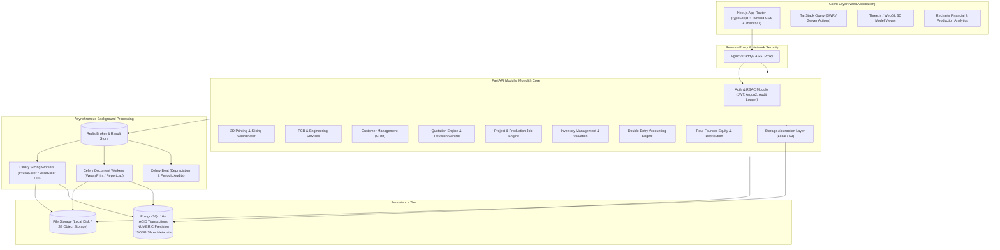
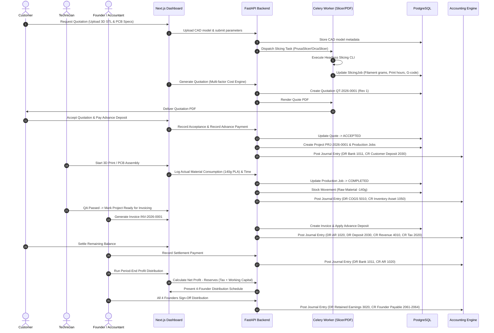

# VisionCraft OS – Complete Business Management System
## System Architecture & Technical Specification

**Company:** VisionCraft  
**Target Platform:** Engineering & Manufacturing Business (FDM 3D Printing, PCB Fabrication, Electronics Prototyping, Engineering Services)  
**Founders:** 4 Co-Founders (Janitha, Lalitha, Thakshila, Melanka)  
**Primary Currency:** Sri Lankan Rupees (LKR)  
**Architecture Pattern:** Modular Monolith with Domain-Driven Boundaries, Event-Driven Background Processing, and Double-Entry Ledger  

---

## 1. Executive Summary & Workspace Environment Findings

### 1.1 Development Environment Audit
A comprehensive inspection of the host environment `/home/janitha/vision-craft-web` was performed:
- **Operating System:** Linux Ubuntu 22.04 LTS (x86_64, Kernel 6.8.0)
- **Compute Resources:** 15.6 GiB RAM (10 GiB available), 784 GiB available NVMe storage
- **Runtime Runtimes:**
  - **Python:** `3.10.12` (Ideal for FastAPI, SQLAlchemy 2.0, Pydantic v2, Celery 5.x)
  - **Node.js:** `v20.20.2` LTS with npm `10.8.2` (Ideal for Next.js 14/15 App Router, React 19/18, TypeScript, Tailwind CSS)
  - **Version Control:** Git 2.34.1
- **Existing Workspace Layout:**
  - `back-end/` (Active modular API)
  - `front-end/` (Active Next.js dashboard)

---

## 2. High-Level System Architecture

VisionCraft OS is designed as a **Modular Monolith** with clean domain separation. Rather than distributing business domains across microservices—which introduces complex 2-phase commits, network latency, and distributed financial reconciliation risks—a modular monolith ensures **strict ACID transactional integrity** across quotations, inventory consumption, invoices, and the double-entry ledger.



### 2.1 Core Architectural Principles
1. **Financial Immutability & Exact Precision:** All currency amounts use `Decimal` in Python and `NUMERIC(15, 2)` (or `NUMERIC(18, 4)` for micro-rates) in PostgreSQL. Floating-point arithmetic is strictly prohibited in financial paths. Finalized journal entries are immutable; corrections require compensatory reversal entries.
2. **Domain Encapsulation:** Modules interact through explicit public service APIs or domain events. Modules never perform cross-domain raw SQL updates on other modules' tables.
3. **Strict Transactional Boundaries:** Financial journal entries and stock movements occur in the exact same database transaction as the business event triggering them (e.g., invoice generation, payment receipt, job completion).
4. **Asynchronous Heavy Computations:** Slicing 3D meshes (STL/3MF/OBJ) and rendering complex multi-page PDF documents are dispatched to Celery workers via Redis. API endpoints return immediately with job tokens for real-time polling or WebSocket updates.
5. **Storage Abstraction:** File operations pass through a generic `StorageService` interface, decoupling code from local filesystem paths and enabling instant switching to AWS S3, Cloudflare R2, or MinIO.

---

## 3. End-to-End Business Lifecycle Flow

The complete operating lifecycle connects sales, engineering, manufacturing, inventory, invoicing, accounting, and founder returns:



---

## 4. Backend Module Structure

Organized cleanly by business domain under `back-end/app/modules/`:

```
back-end/
├── alembic/                          # Alembic database migrations
│   ├── env.py
│   ├── script.py.mako
│   └── versions/
├── app/
│   ├── __init__.py
│   ├── main.py                       # FastAPI application factory & router registration
│   ├── config.py                     # Pydantic BaseSettings (Environment configurations)
│   ├── core/                         # Cross-cutting foundational services
│   │   ├── database.py               # SQLAlchemy async engine, SessionLocal, Base model
│   │   ├── security.py               # JWT tokens, Argon2 password hashing, RBAC decorators
│   │   ├── dependencies.py           # DB session, Current User, Role checkers
│   │   ├── exceptions.py             # Custom domain exceptions & HTTP handlers
│   │   ├── logging.py                # Structured logging (structlog)
│   │   └── storage/                  # Storage abstraction provider
│   │       ├── base.py               # Abstract StorageService class
│   │       ├── local.py              # Local disk storage provider
│   │       └── s3.py                 # S3 / MinIO storage provider
│   ├── tasks/                        # Celery tasks & queues
│   │   ├── celery_app.py             # Celery instance configuration & routes
│   │   ├── slicing_tasks.py          # Headless 3D slicer worker execution
│   │   ├── pdf_tasks.py              # Asynchronous PDF document generation
│   │   └── accounting_tasks.py       # Automated depreciation & trial balance caching
│   └── modules/                      # Encapsulated Business Modules
│       ├── auth/                     # Users, Roles, Permissions, Audit Logs
│       │   ├── models.py
│       │   ├── schemas.py
│       │   ├── service.py
│       │   └── router.py
│       ├── customers/                # Customer directory, CRM, Credit balances
│       ├── printing_3d/              # 3D Printing Domain
│       │   ├── engine/               # Slicer CLI wrapper & G-code metadata parser
│       │   │   ├── base.py
│       │   │   ├── prusa.py
│       │   │   ├── orca.py
│       │   │   └── parser.py
│       │   ├── estimator/            # Cost calculation engine
│       │   ├── models.py
│       │   ├── schemas.py
│       │   ├── service.py
│       │   └── router.py
│       ├── engineering/              # PCB specifications & engineering services catalog
│       ├── quotations/               # Multi-item quotations, revisions, PDF rendering
│       ├── projects/                 # Projects, production jobs, time tracking
│       ├── invoices/                 # Invoicing, payment receipts, balance tracking
│       ├── inventory/                # 3D & Electronics catalog, suppliers, stock movements
│       ├── accounting/               # Double-Entry Ledger, Chart of Accounts, P&L, Balance Sheet
│       │   ├── ledger_service.py     # Journal entry creation, validation, immutability
│       │   ├── financial_reports.py  # P&L, Balance Sheet, Trial Balance, Cash Flow
│       │   ├── asset_service.py      # Fixed asset depreciation schedules
│       │   ├── models.py
│       │   ├── schemas.py
│       │   └── router.py
│       ├── founders/                 # 4-Founder capital, out-of-pocket expenses, profit sharing
│       │   ├── profit_service.py     # Reserve rules & multi-signature approvals
│       │   ├── models.py
│       │   ├── schemas.py
│       │   └── router.py
│       └── dashboard/                # Analytics aggregations & KPIs
├── tests/
│   ├── conftest.py
│   ├── test_auth.py
│   ├── test_slicer_parser.py
│   ├── test_cost_estimator.py
│   ├── test_accounting_ledger.py     # Debit/credit balance & reversal tests
│   ├── test_founder_distribution.py  # Multi-sig & reserve rule enforcement tests
│   └── test_quotation_workflow.py
├── Dockerfile.backend
├── Dockerfile.worker
├── docker-compose.yml
├── requirements.txt
├── requirements-dev.txt
└── .env.example
```

---

## 5. Frontend Navigation & Page Architecture

Built on **Next.js (App Router)** with TypeScript, Tailwind CSS, shadcn/ui components, Lucide icons, and Recharts:

```
front-end/src/app/
├── (auth)/
│   └── login/                        # Clean, branded login page with MFA support
├── (dashboard)/
│   ├── layout.tsx                    # Shared persistent shell: Collapsible Sidebar, Header, Global Search
│   ├── page.tsx                      # Executive Command Dashboard (KPIs, Cash Flow, Alerts)
│   ├── 3d-printing/
│   │   ├── page.tsx                  # Active 3D print jobs & printer hardware fleet status
│   │   ├── upload/page.tsx           # Drag-and-drop CAD model uploader with WebGL 3D preview
│   │   ├── slicing/[id]/page.tsx     # Slicing configuration, profile selector, slicer runner
│   │   ├── cost-calculator/page.tsx  # Dynamic price estimation simulation sandbox
│   │   ├── printers/page.tsx         # 3D printer fleet management & maintenance logs
│   │   └── filaments/page.tsx        # Spool inventory, color picker, stock tracking
│   ├── engineering/
│   │   ├── page.tsx                  # Engineering projects summary
│   │   ├── pcb-quote/page.tsx        # PCB design & fabrication technical spec builder
│   │   └── service-catalog/page.tsx  # Hourly & fixed-rate engineering service definitions
│   ├── customers/
│   │   ├── page.tsx                  # Filterable customer table (Individual vs Business)
│   │   └── [id]/page.tsx             # Customer 360 view: Quotes, Invoices, Projects, Balances
│   ├── quotations/
│   │   ├── page.tsx                  # Quotations list with status filters & revision flags
│   │   ├── new/page.tsx              # Comprehensive multi-product quote builder
│   │   └── [id]/page.tsx             # Quote preview, PDF export, revision diff, "Convert to Project"
│   ├── projects/
│   │   ├── page.tsx                  # Kanban board & tabular view of active engineering orders
│   │   └── [id]/page.tsx             # Production jobs, time logs, material allocation, attachments
│   ├── invoices/
│   │   ├── page.tsx                  # Invoices list, aging report (Current, 30d, 60d+ overdue)
│   │   ├── new/page.tsx              # Invoice builder (from accepted quotation or milestone)
│   │   └── [id]/page.tsx             # Invoice view, PDF receipt, "Record Payment" modal
│   ├── inventory/
│   │   ├── page.tsx                  # Categorized inventory (3D Printing / Electronics / Components)
│   │   ├── items/[id]/page.tsx       # Stock movement history, average cost, reorder alerts
│   │   └── suppliers/page.tsx        # Vendor directory & Purchase Orders
│   ├── accounting/
│   │   ├── page.tsx                  # Financial statements overview (P&L, Balance Sheet, Cash Flow)
│   │   ├── chart-of-accounts/page.tsx# Interactive hierarchical Chart of Accounts tree
│   │   ├── journal/page.tsx          # General Journal with audit filter & "Create Reversal"
│   │   ├── reports/page.tsx          # Exportable financial statements (PDF / Excel)
│   │   └── assets/page.tsx           # Fixed Asset register & automated depreciation logs
│   ├── founders/
│   │   ├── page.tsx                  # 4-Founder dashboard: Capital accounts, current dues, drawings
│   │   ├── expenses/page.tsx         # Out-of-pocket expense reimbursement claims with receipts
│   │   ├── capital/page.tsx          # Capital injections & equity adjustments
│   │   └── profit-distribution/page.tsx # Profit pool calculator, reserve sliders, 4-way sign-off
│   ├── team/page.tsx                 # User directory, RBAC role management, audit trail log
│   └── settings/page.tsx             # System parameters, pricing profiles, tax rules, currency
```

---

## 6. Slicer Integration & Cost Estimation Architecture

### 6.1 Slicer CLI Integration (PrusaSlicer / OrcaSlicer)
Slicing is CPU-intensive and must never block web requests. The architecture uses Celery workers running headless slicer binaries:
1. **Model Ingestion & Sanitization:**
   - Supported extensions: `.stl`, `.3mf`, `.obj`.
   - File integrity: Validate MIME types, magic bytes (`solid` / binary header for STL, PK zip header for 3MF).
   - Filename sanitization: Generate deterministic UUID storage paths to prevent shell injection or directory traversal.
2. **Headless Execution:**
   - Command line execution uses strictly non-shell array invocations (`subprocess.run(["prusa-slicer", ...], shell=False)`).
   - In environments without native X11 displays, `xvfb-run -a` wraps the invocation if the specific slicer build requires a virtual frame buffer.
   - Resource controls: CPU pinning, memory ceiling (2GB per slice task), and execution timeout (120 seconds).
3. **Telemetry Extraction:**
   - Celery worker parses generated G-code metadata comments:
     - Filament used in grams: `; filament used [g] = 142.35`
     - Filament used in length: `; filament used [mm] = 47820.5`
     - Estimated print time: `; estimated printing time (normal mode) = 4h 12m 30s` -> converted to `15150` seconds.
     - Layer count and temperature profiles.
   - Extracted telemetry is persisted into `slicing_jobs` in PostgreSQL.

### 6.2 Multi-Factor Price Estimation Engine
Slicer metadata only gives theoretical machine time and filament usage. The **Workshop OS Price Engine** computes the true industrial manufacturing cost:

$$\text{Filament Cost} = \text{Filament Weight (g)} \times \left(1 + \frac{\text{Wastage Allowance \%}}{100}\right) \times \text{Cost per Gram (LKR)}$$

$$\text{Machine Cost} = \left(\frac{\text{Duration (seconds)}}{3600}\right) \times \text{Hourly Machine Depreciation \& Maintenance (LKR)}$$

$$\text{Electricity Cost} = \left(\frac{\text{Duration (seconds)}}{3600}\right) \times \left(\frac{\text{Printer Power Rating (W)}}{1000}\right) \times \text{Electricity Tariff (LKR/kWh)}$$

$$\text{Labor Cost} = (\text{Prep Hours} \times \text{Technician Hourly Rate}) + (\text{Post-Processing Hours} \times \text{Post-Processing Rate})$$

$$\text{Direct Manufacturing Cost} = \text{Filament Cost} + \text{Machine Cost} + \text{Electricity Cost} + \text{Labor Cost}$$

$$\text{Risk-Adjusted Cost} = \text{Direct Manufacturing Cost} \times \left(1 + \frac{\text{Print Failure Risk Contingency \%}}{100}\right)$$

$$\text{Final Suggested Price} = \max\left(\text{Minimum Order Charge}, \text{Risk-Adjusted Cost} \times \left(1 + \frac{\text{Profit Margin \%}}{100}\right)\right)$$

*Note:* Founders or sales staff can apply manual price overrides, but an explicit justification must be recorded in the audit trail.

---

## 7. Four-Founder Accounting & Profit Distribution Architecture

### 7.1 Separation of Concepts
To prevent founder friction, four distinct concepts are maintained in separate ledger accounts:
1. **Ownership Percentage:** Legal company ownership equity (e.g., 25% each, or agreed ratios).
2. **Profit-Sharing Ratio:** Contractual allocation of distributable operating profit (can vary based on operational roles).
3. **Capital Accounts (Balance Sheet - Equity):**
   - Tracks Initial Capital Contributed + Additional Capital Injections + Retained Profit Allocations - Drawings/Distributions.
4. **Founder Reimbursement Accounts (Balance Sheet - Current Liability: "Due to Founder X"):**
   - When a founder pays for business expenses (filaments, ICs, tools, travel) out-of-pocket, the company owes them money. This is a **liability**, not equity. It is reimbursed tax-free via bank transfer or can be converted to capital upon unanimous approval.

### 7.2 Controlled Profit Distribution Workflow
The system strictly prevents the dangerous mistake of distributing "paper profits" when the business lacks liquidity:

1. **Calculate Audited Net Operating Profit:**
   $$P_{\text{net}} = \text{Revenues} - \text{COGS} - \text{Operating Expenses} - \text{Depreciation}$$
2. **Mandatory Reserve Withholding:**
   - **Working Capital Reserve (e.g. 20%):** Retained to fund ongoing inventory and operations.
   - **Tax Reserve (e.g. 15%):** Retained to meet upcoming corporate tax obligations.
   - **Emergency Maintenance Reserve (e.g. 5%):** Retained for printer and PCB equipment maintenance.
   $$\text{Distributable Profit Pool} = P_{\text{net}} \times (1 - \text{Total Reserve \%})$$
3. **Liquidity Safeguard Check:**
   $$\text{Distributable Pool} \le \text{Available Bank Cash} - \text{Short-Term Payables (Next 30 Days)}$$
   *If available cash is lower than the distributable pool, the system caps distributions at the safe liquid amount!*
4. **Allocation & Multi-Founder Sign-Off:**
   - The distributable pool is split according to each founder's profit-sharing ratio.
   - A distribution proposal is generated in `profit_distribution_runs`.
   - **All 4 co-founders must approve the distribution run** via their authenticated accounts.
5. **Ledger Posting:**
   - Once all 4 sign-offs are collected, the system generates double-entry records:
     - **DEBIT:** Retained Earnings (Account `3020`)
     - **CREDIT:** Founder Distribution Payable (Accounts `2061`, `2062`, `2063`, `2064`)
   - Upon actual bank disbursement:
     - **DEBIT:** Founder Distribution Payable (`2061`..`2064`)
     - **CREDIT:** Bank Account (`1011`)

---

## 8. Technical Risks & Mitigation Strategies

| Risk Category | Potential Impact | Architectural Mitigation |
| :--- | :--- | :--- |
| **Slicer Execution Security & DoS** | Malicious STL/3MF files crashing slicer, path traversal, or command injection. | Strict file magic byte verification; UUID-based sanitized file paths; execute via non-shell argument arrays (`shell=False`); sandboxed worker directory; CPU & memory limits; 120s execution timeout. |
| **Financial Ledger Inconsistency** | Rounding errors, floating-point drift, unposted debits/credits. | Python `Decimal` and PostgreSQL `NUMERIC(15, 2)` throughout; strict DB trigger ensuring `Sum(Debit) == Sum(Credit)`; immutable journal records (no `DELETE`/`UPDATE` on posted entries; reversals only); pessimistic row locking on payment applications. |
| **Founder Disagreements on Capital/Profits** | Confusion between personal expenses, capital, and profit shares. | Strict separation of Capital Accounts (Equity) from Reimbursement Accounts (Liabilities); automated expense claim approvals; multi-signature 4-founder sign-off on profit runs; liquid cash checks before distribution. |
| **Slicer Estimate Inaccuracy** | Slicer underestimating real-world production costs, leading to financial loss. | Multi-factor dynamic price engine incorporating machine wear, electricity tariffs, technician setup time, post-processing, and failure contingency rates. |
| **System Scalability & Long-Running Tasks** | Slicing or PDF rendering blocking user interface or crashing server. | Asynchronous Celery queues with Redis; dedicated queues for slicing vs. PDFs; persistent job polling and status tracking. |

---

## 9. Phased Implementation Roadmap

To maintain clean code quality, stability, and proper testing at every step, development will proceed in 10 sequential phases:

```mermaid
flowchart LR
    P1["Phase 1: Foundation, DB, Storage & RBAC"] --> P2["Phase 2: Double-Entry Ledger & Founders"]
    P2 --> P3["Phase 3: Inventory & Sourcing"]
    P3 --> P4["Phase 4: 3D Slicing & Cost Engine"]
    P4 --> P5["Phase 5: PCB & Engineering Services"]
    P5 --> P6["Phase 6: CRM, Quotations & Revisions"]
    P6 --> P7["Phase 7: Projects & Production Jobs"]
    P7 --> P8["Phase 8: Invoices & Payments"]
    P8 --> P9["Phase 9: Dashboards & Financial Reports"]
    P9 --> P10["Phase 10: Docker, Testing & Hardening"]
```



- **Phase 1: Foundation & Core Infrastructure**
  - Database schema & Alembic migrations setup.
  - JWT Authentication, RBAC (Super Admin, Founder, Accountant, Technician, Employee), Audit Logging.
  - Storage abstraction (Local file storage with S3 interface).
  - Next.js workspace setup with Tailwind CSS, shadcn/ui, and layout shell.
- **Phase 2: Accounting Engine & Four-Founder Module**
  - Chart of Accounts, Journal Entry engine (with strict debit=credit validation).
  - Fixed assets & depreciation schedule calculator.
  - Four-founder capital tracking, personal expense claims, reimbursement workflow, and 4-way sign-off profit distribution engine.
- **Phase 3: Inventory Management & Sourcing**
  - 3D printing inventory (filaments, resins, nozzles) & Electronics inventory (ICs, passives, connectors, PCBs).
  - Suppliers, Purchase Orders, Stock Movements, weighted average cost accounting.
- **Phase 4: 3D Printing Management & Slicer Integration**
  - CAD model uploads (STL, 3MF, OBJ) & 3D WebGL viewer.
  - Headless PrusaSlicer/OrcaSlicer Celery worker integration.
  - G-code telemetry extraction & Multi-factor Price Estimation Engine.
- **Phase 5: PCB & Engineering Services**
  - Technical specification builder for PCB design, fabrication, assembly, and firmware development.
  - Engineering service catalog with configurable hourly and fixed rates.
- **Phase 6: CRM & Quotation Management**
  - Customer directory (Individual & Business), credit limits, and CRM history.
  - Multi-service quotation builder, sequential numbering (`QT-2026-0001`), revision control, and professional PDF generation.
- **Phase 7: Project & Production Job Management**
  - Converting accepted quotes to projects (`PRJ-2026-0001`) and production jobs (`JOB-2026-0001`).
  - Kanban job board, technician time tracking, and material consumption logging linked directly to inventory & COGS.
- **Phase 8: Invoicing & Payment Processing**
  - Sequential invoice generation (`INV-2026-0001`), advance deposits, and partial payments.
  - Payment receipts, PDF invoices, and automated Accounts Receivable journal posting.
- **Phase 9: Executive Dashboard, Analytics & Reporting**
  - Executive financial dashboard: Revenue, Expenses, Net Profit, AR aging, Job throughput.
  - Financial reports: Profit & Loss statement, Balance Sheet, Cash Flow statement.
  - Four-founder personal financial portals.
- **Phase 10: Testing, Hardening & Docker Deployment**
  - Automated Pytest test suite covering financial ledger integrity, slicer parsing, and cost estimation.
  - Docker Compose orchestration (PostgreSQL, Redis, FastAPI, Celery Worker, Next.js).
  - Production security checklist, documentation, and user guide.

